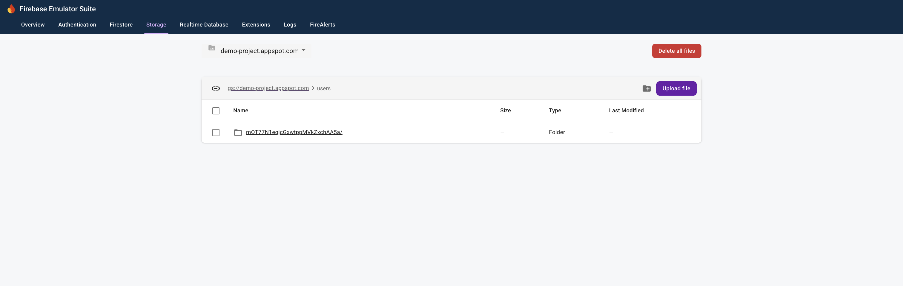
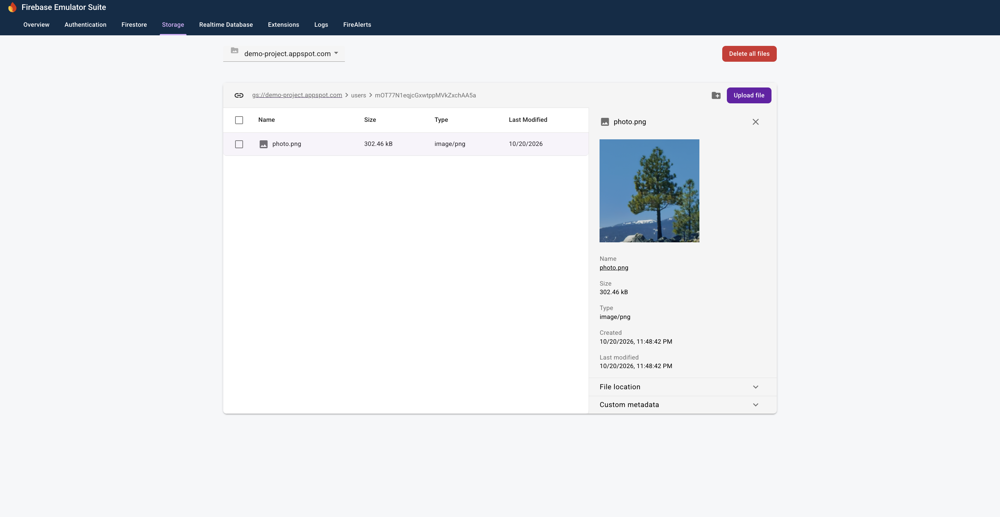
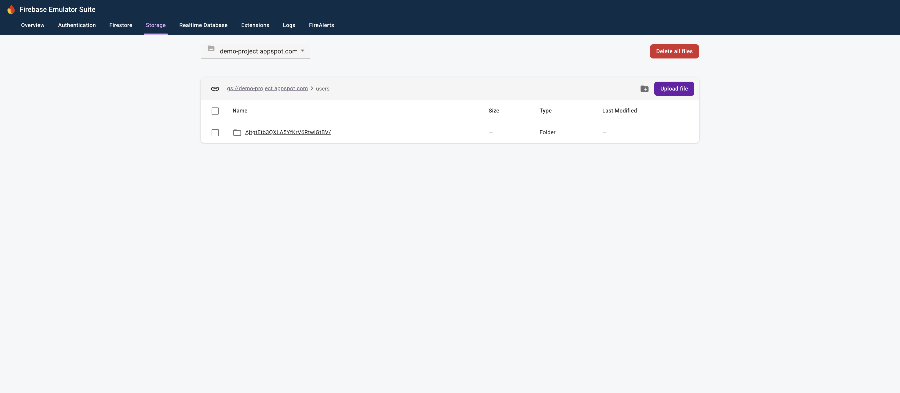
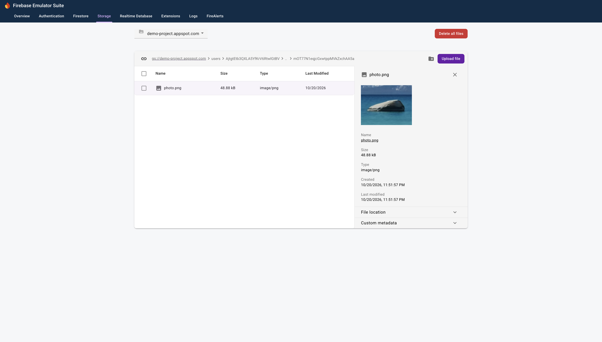

# Repro for issue 11301

## Versions

firebase-tools: v15.34.0

## Steps to reproduce

1. Run `firebase emulators:start --project demo-project`
2. Open "http://localhost:4000/" in browser
3. Click `Sign in` for `User B`
4. Click `Upload Photo` for `User B`
5. Check storage emulator UI http://localhost:4000/storage
   - There should be a folder `users/{USER_B_ID}` (expected)

   - There should be a file `users/{USER_B_ID}/photo.png` (expected)
     - The image is a tree

6. Click `Sign in` for `User A`
7. Click `Upload Photo` for `User A`
8. Check storage emulator UI http://localhost:4000/storage
   - There should be a folder `users/{USER_A_ID}` (expected)
   - The file uploaded by `User B` along with the `User B` folder is missing (unexpected)

   - There should be a file `users/{USER_A_ID}/../{USER_B_ID}/photo.png` (expected)
     - The image is a rock

